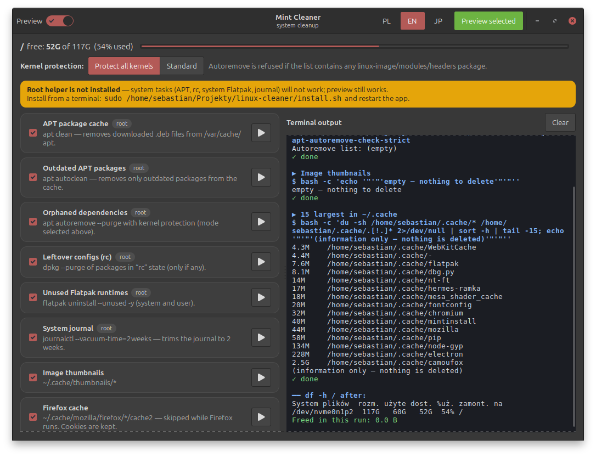

# 🧹 Cleaner (Czyściciel / クリーナー)

A small, friendly GTK3 system cleaner for **Linux Mint 22 / Ubuntu 24.04 / Debian-based** systems.
It cleans the APT cache, orphaned packages (with kernel protection), leftover configs, unused Flatpaks,
old journal logs, thumbnails, Firefox cache and the Trash — with a **Preview** mode (on by default, deletes nothing),
a live terminal pane and a tightly-restricted root helper (7 fixed sudo commands, no password stored).
UI in **Polish, English and Japanese**.



## 📖 User guide — step by step
- 🇵🇱 [Instrukcja po polsku](docs/README.pl.md)
- 🇬🇧 [English guide](docs/README.en.md)
- 🇯🇵 [日本語ガイド](docs/README.ja.md)

## ⚡ Quick start
```bash
sudo apt update && sudo apt install -y python3 python3-gi gir1.2-gtk-3.0 flatpak
git clone https://github.com/SebMaliszewski/linux-cleaner.git
cd linux-cleaner && sudo ./install.sh
```
Uninstall: `sudo ./uninstall.sh [--purge-config]`. Japanese fonts: `sudo apt install -y fonts-noto-cjk`.

## Development
```bash
python3 mint-cleaner.py                       # runs from the checkout; without helper a banner shows, preview works
MINT_CLEANER_LANG=ja python3 mint-cleaner.py  # force a language (not saved)
bash tests/test-helper.sh                     # helper tests with fake apt lists, no root, no removals
```

## License
MIT © 2026 Sebastian Maliszewski — see [LICENSE](LICENSE).
Pure Python + GTK; no ffmpeg or other bundled third-party binaries.
