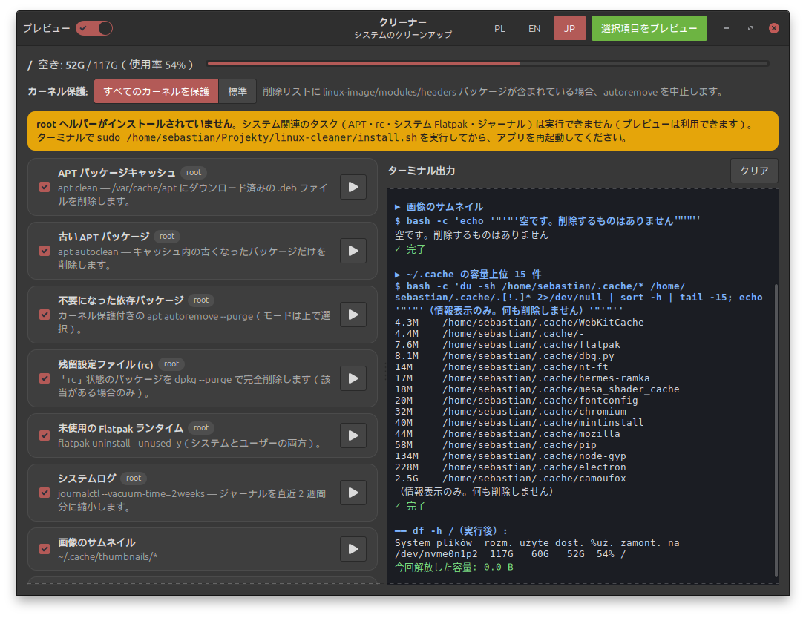

# 🧹 クリーナー — つかいかた（日本語）

**言語:** [Polski](README.pl.md) · [English](README.en.md) · **日本語**



## 1. クリーナーってなに？ 🤔

パソコンには、もう使わない古いものがたくさんたまっています。もう遊ばなくなったおもちゃみたいにね。
**クリーナー**は、それを見つけてお片づけし、空き容量をふやします。お片づけできるもの：

- 📦 古いアップデート用ファイル（APT キャッシュ、古いパッケージ）
- 🧩 もうだれも使っていない“おてつだい”パッケージ（autoremove — カーネルは守られます！）
- 🗒️ 消したアプリの設定の残り（「rc」パッケージ）
- 📦 使っていない Flatpak の部品
- 📜 システムの古い日記（2週間より前のログ）
- 🖼️ 画像の小さなプレビュー（サムネイル）
- 🦊 Firefox のキャッシュ（ログインや Cookie はそのまま！）
- 🗑️ ゴミ箱

`~/.cache` の中の大きいもの上位15個も表示します（見るだけで、消しません）。

## 2. ひつようなもの 🧰

- **Linux Mint 22**、**Ubuntu 24.04**、または **Debian 系**の Linux が入ったパソコン
- インターネット
- あなたのパスワード（ログインするときのもの）

## 3. 端末（ターミナル）をひらく 🖥️

端末は、コマンドを入力するための窓です。

1. **Ctrl + Alt + T** をいっしょに押します。
2. カーソルが点滅する窓が出てきます。🎉

ヒント：端末に貼り付けるときは **Ctrl + Shift + V** を使います（Ctrl + V だけではありません）。

## 4. `sudo` ってなに？ 🔑

いくつかの作業は「おとなの作業」で、パソコンのボス（**root** といいます）しかできません。
`sudo` は「ボスとしてやってください」という意味です。

- すると、**あなたのパスワード**を聞かれます。
- ⚠️ 入力しても**画面に何も出ません**（●や * も出ません）。これでだいじょうぶ！そのまま入力して **Enter** を押してください。

## 5. ひつようなソフトを入れる 🧱

この1行をコピーして端末に貼り付け、**Enter** を押します：

```bash
sudo apt update && sudo apt install -y python3 python3-gi gir1.2-gtk-3.0 flatpak
```

- `python3` — クリーナーを書いている言語です。
- `python3-gi` と `gir1.2-gtk-3.0` — 窓やボタンを作ります。
- `flatpak` — なくても動きます。Flatpak のお片づけに使います。

日本語の文字をきれいに表示するには、日本語フォントを入れます：

```bash
sudo apt install -y fonts-noto-cjk
```

（インストーラーも Python と GTK を自動でチェックし、足りなければ入れてくれます。）

## 6. クリーナーをダウンロードする ⬇️

**やりかた A — git を使う**（先に `sudo apt install -y git`）：

```bash
cd ~
git clone https://github.com/SebMaliszewski/linux-cleaner.git
```


**やりかた B — ZIP ファイル：**

1. プロジェクトのページで **Code → Download ZIP** をクリックします。
2. **ダウンロード**フォルダーを開き、ZIP を右クリックして **ここに展開** を選びます。
3. フォルダー名を `linux-cleaner` に変えて（例：`linux-cleaner-main` から）、ホームフォルダーに移します。

## 7. クリーナーをインストールする 🛠️

```bash
cd ~/linux-cleaner && sudo ./install.sh
```

パスワードを入力して（何も表示されないのはふつうです 🙂）Enter。最後に **Done.** と出れば完了です。

⚠️ かならず**自分のアカウント**から `sudo` で実行してください。root のままや `sudo su` ではだめです。インストーラーは「ヘルパーを使っていい人」として*あなた*を覚えます。

### 「root ヘルパー」ってなに？ 🤖

クリーナー本体は、ふつうの力しかないふつうのアプリです。おとなの作業（APT、システムの Flatpak、ログ）のときだけ、小さなヘルパーを呼びます。ヘルパーはボスとして動けますが、**決められた7つの作業しか知りません**。ボタンが7つしかないロボットのようなものです。

### `install.sh` はどこに何を置くの？ 📂

| なに | どこ |
|---|---|
| アプリ | `/opt/mint-cleaner/mint-cleaner.py` |
| root ヘルパー | `/usr/local/sbin/mint-cleaner-helper` |
| 許可のルール | `/etc/sudoers.d/mint-cleaner` |
| メニューの項目 | `/usr/share/applications/mint-cleaner.desktop` |
| アイコン | `/usr/share/icons/hicolor/scalable/apps/mint-cleaner.svg` |

このルールで、**あなただけ**が、**この7つのコマンドだけ**をパスワードなしで実行できます：
`apt-clean`、`apt-autoclean`、`apt-autoremove-strict`、`apt-autoremove-standard`、`rc-purge`、`flatpak-system`、`journal-vacuum`。

### どうして安全なの？ 🛡️

- 🔒 **パスワードはどこにも保存されません。**
- 決まった7つのコマンドだけ。ほかの言葉やワイルドカードは使えません。
- アプリとヘルパーは root のものなので、ほかのプログラムがこっそり書きかえられません。
- ルールのファイルは、使う前に `visudo` でチェックされます。

## 8. つかいかた ▶️

1. メニューから **クリーナー** を起動します（または `python3 /opt/mint-cleaner/mint-cleaner.py`）。
2. お片づけしたいものに ✅ を付けます。カードの ▶ ボタンは、その1つだけを実行します。
3. 最初は **プレビュー** スイッチが **オン** → 👀 消すものを*見せるだけ*です。**何も消しません。**
4. よければ **プレビューをオフ** → ボタンが **赤く** 🔴 なります。押すと本当にお片づけします。
5. 下の端末の欄を見てください。最後に、どれだけ空いたかが出ます。🎉

**言語：** 上の **PL | EN | JP** を押すと、すぐに切りかわります。

**カーネル保護**（カーネルは Linux の心臓です ❤️）：

- **すべてのカーネルを保護**（はじめの設定）— カーネルが1つでも消されそうなら、止まって何も消しません。いちばん安全です。
- **標準** — 古いカーネルは消してもいいけれど、**いま使っている**カーネルは絶対に消しません。

## 9. アップデート 🔄

```bash
cd ~/linux-cleaner && git pull && sudo ./install.sh
```

（ZIP の場合：新しい ZIP をダウンロードして展開し、その新しいフォルダーで `sudo ./install.sh` を実行します。）

## 10. アンインストール 👋

```bash
cd ~/linux-cleaner && sudo ./uninstall.sh
```

設定（`~/.config/mint-cleaner`）もいっしょに消すには：

```bash
cd ~/linux-cleaner && sudo ./uninstall.sh --purge-config
```

## 11. うまくいかないとき 🩹

- 🟨 **黄色い帯「root ヘルパーがインストールされていません」** → ヘルパーがありません。`cd ~/linux-cleaner && sudo ./install.sh` を実行して、クリーナーを起動しなおしてください。（プレビューは使えます。）
- 🦊 **「Firefox が起動中です … スキップしました」** → Firefox を完全に終了して、もう一度ためしてください。
- ⛔ `./install.sh` で **「Permission denied」（許可がありません）** → フォルダーがちがうか、`sudo` を忘れています。`cd ~/linux-cleaner && sudo bash ./install.sh` をためしてください。
- ✗ **「権限がありません。ヘルパーをインストールしてください」** → 自分のアカウントからインストーラーをもう一度実行します。
- **「Refusing: run via sudo from the user account…」** → root で実行しています。自分でログインして `sudo ./install.sh` を使ってください。
- **「BLOCKED … kernel」** → カーネル保護がはたらきました。何も消していません。よかった！👍
- **日本語が □□□ になる** → `sudo apt install -y fonts-noto-cjk` を実行して、起動しなおします。
- **`No module named 'gi'`** → 手順5のコマンドをもう一度実行します。

---
MIT ライセンス © 2026 Sebastian Maliszewski
