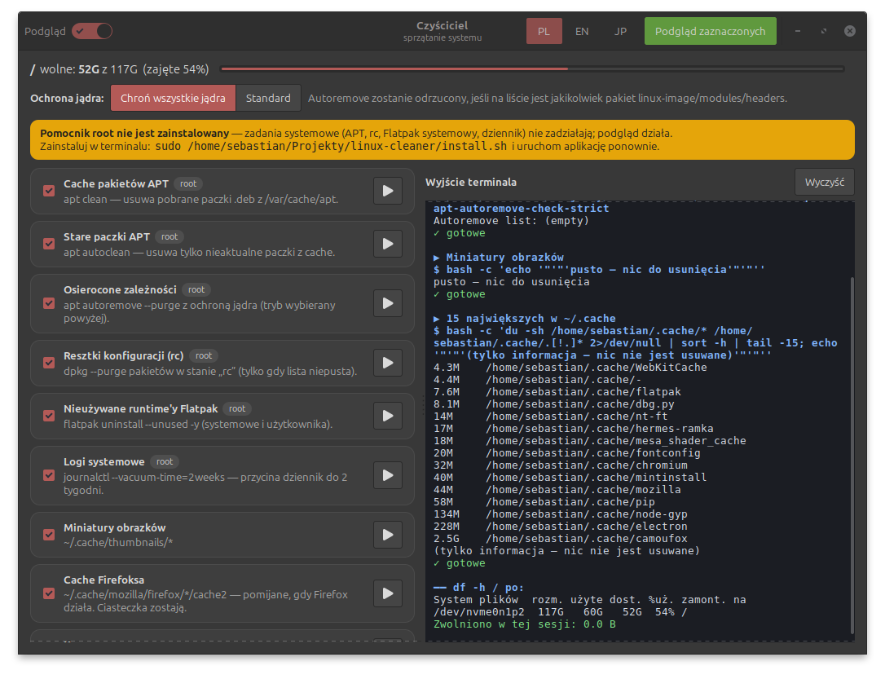

# 🧹 Czyściciel — instrukcja (polski)

**Języki:** **Polski** · [English](README.en.md) · [日本語](README.ja.md)



## 1. Co robi Czyściciel? 🤔

Komputer trzyma dużo starych rzeczy, których już nie potrzebuje — jak zabawki, którymi nikt się nie bawi.
**Czyściciel** je znajduje i sprząta, żeby było więcej wolnego miejsca. Umie wyczyścić:

- 📦 stare pobrane pliki aktualizacji (cache APT, przestarzałe paczki),
- 🧩 paczki‑pomocników, których nikt już nie używa (autoremove — jądra są chronione!),
- 🗒️ resztki ustawień po usuniętych programach (paczki „rc”),
- 📦 nieużywane kawałki Flatpaka,
- 📜 stary dziennik systemu (wpisy starsze niż 2 tygodnie),
- 🖼️ małe podglądy obrazków (miniatury),
- 🦊 cache Firefoksa (loginy i ciasteczka zostają!),
- 🗑️ Kosz.

Pokazuje też 15 największych rzeczy w `~/.cache` (tylko do oglądania, nic tam nie usuwa).

## 2. Czego potrzebujesz? 🧰

- Komputera z **Linux Mint 22**, **Ubuntu 24.04** albo innym Linuksem **opartym na Debianie**.
- Internetu.
- Swojego hasła (tego, którym się logujesz).

## 3. Otwórz terminal 🖥️

Terminal to okienko, w którym wpisuje się polecenia.

1. Naciśnij razem **Ctrl + Alt + T**.
2. Pojawi się okno z mrugającym kursorem. 🎉

Podpowiedź: wklejanie w terminalu to **Ctrl + Shift + V** (a nie samo Ctrl + V).

## 4. Co to jest `sudo`? 🔑

Niektóre zadania są „dla dorosłych” — może je zrobić tylko szef komputera (nazywa się **root**).
`sudo` znaczy: *„Proszę, zrób to jako szef.”*

- Komputer zapyta wtedy o **Twoje hasło**.
- ⚠️ Gdy je wpisujesz, **nic się nie pokazuje** — żadnych kropek ani gwiazdek. To normalne! Po prostu wpisz i naciśnij **Enter**.

## 5. Zainstaluj to, czego Czyściciel potrzebuje 🧱

Skopiuj tę linijkę, wklej do terminala i naciśnij **Enter**:

```bash
sudo apt update && sudo apt install -y python3 python3-gi gir1.2-gtk-3.0 flatpak
```

- `python3` — język, w którym napisany jest Czyściciel.
- `python3-gi` + `gir1.2-gtk-3.0` — robią okienka i przyciski.
- `flatpak` — opcjonalnie, tylko do sprzątania aplikacji Flatpak.

Chcesz, żeby japoński wyglądał dobrze? Doinstaluj japońskie literki (czcionki):

```bash
sudo apt install -y fonts-noto-cjk
```

(Instalator sam też sprawdza Pythona + GTK i doinstaluje je, jeśli ich brakuje.)

## 6. Pobierz Czyściciela ⬇️

**Sposób A — przez git** (potrzebny `sudo apt install -y git`):

```bash
cd ~
git clone https://github.com/SebMaliszewski/linux-cleaner.git
```


**Sposób B — plik ZIP:**

1. Na stronie projektu kliknij **Code → Download ZIP**.
2. Otwórz folder **Pobrane**, kliknij ZIP prawym przyciskiem → **Rozpakuj tutaj**.
3. Zmień nazwę folderu na `linux-cleaner` (np. z `linux-cleaner-main`) i przenieś go do folderu domowego.

## 7. Zainstaluj Czyściciela 🛠️

```bash
cd ~/linux-cleaner && sudo ./install.sh
```

Wpisz hasło (nic nie widać — to normalne 🙂) i naciśnij Enter. Na końcu zobaczysz **Done.**

⚠️ Uruchamiaj przez `sudo` ze **swojego** konta — nie jako root i nie przez `sudo su`. Instalator zapamiętuje *Ciebie* jako osobę, która może używać pomocnika.

### Co to jest „pomocnik root”? 🤖

Sam Czyściciel to zwykła aplikacja ze zwykłymi uprawnieniami. Do zadań „dla dorosłych” (APT, systemowy Flatpak, dziennik) woła malutkiego pomocnika, który może działać jako szef — ale zna **tylko 7 dokładnych zadań** i nic więcej. Jak robot, który ma tylko 7 przycisków.

### Co `install.sh` kładzie i gdzie? 📂

| Co | Gdzie |
|---|---|
| aplikacja | `/opt/mint-cleaner/mint-cleaner.py` |
| pomocnik root | `/usr/local/sbin/mint-cleaner-helper` |
| reguła uprawnień | `/etc/sudoers.d/mint-cleaner` |
| skrót w menu | `/usr/share/applications/mint-cleaner.desktop` |
| ikona | `/usr/share/icons/hicolor/scalable/apps/mint-cleaner.svg` |

Reguła pozwala **tylko Tobie** uruchamiać **tylko te 7 dokładnych poleceń** bez hasła:
`apt-clean`, `apt-autoclean`, `apt-autoremove-strict`, `apt-autoremove-standard`, `rc-purge`, `flatpak-system`, `journal-vacuum`.

### Dlaczego to bezpieczne? 🛡️

- 🔒 **Hasło nie jest nigdzie zapisywane.**
- Tylko 7 stałych poleceń, żadnych dodatkowych słów ani gwiazdek (wildcardów).
- Aplikacja i pomocnik należą do roota, więc inne programy nie mogą ich po cichu zmienić.
- Plik reguły jest sprawdzany przez `visudo`, zanim zacznie działać.

## 8. Jak używać ▶️

1. Otwórz menu i uruchom **Czyściciel** (albo wpisz `python3 /opt/mint-cleaner/mint-cleaner.py`).
2. Zaznacz ✅ to, co chcesz wyczyścić. Przycisk ▶ na karcie uruchamia tylko tę jedną rzecz.
3. Przełącznik **Podgląd** na starcie jest **WŁĄCZONY** → 👀 Czyściciel tylko *pokazuje*, co by usunął. **Nic nie jest usuwane.**
4. Pasuje? **Wyłącz Podgląd** → przycisk zrobi się **czerwony** 🔴. Kliknij, żeby naprawdę posprzątać.
5. Patrz w okienko terminala: na końcu zobaczysz, ile miejsca odzyskałeś. 🎉

**Język:** kliknij **PL | EN | JP** na górze. Zmienia się od razu.

**Ochrona jądra** (jądro to serce Linuksa ❤️):

- **Chroń wszystkie jądra** (domyślnie) — jeśli sprzątanie miałoby usunąć *jakiekolwiek* jądro, Czyściciel się zatrzyma i nic nie usunie. Najbezpieczniej.
- **Standard** — stare jądra mogą zostać usunięte, ale jądro, którego używasz **teraz**, nigdy.

## 9. Aktualizacja 🔄

```bash
cd ~/linux-cleaner && git pull && sudo ./install.sh
```

(Z ZIP‑em: pobierz nowy ZIP, rozpakuj i uruchom `sudo ./install.sh` w nowym folderze.)

## 10. Odinstalowanie 👋

```bash
cd ~/linux-cleaner && sudo ./uninstall.sh
```

Razem z Twoimi ustawieniami (`~/.config/mint-cleaner`):

```bash
cd ~/linux-cleaner && sudo ./uninstall.sh --purge-config
```

## 11. Coś nie działa? 🩹

- 🟨 **Żółty pasek „Pomocnik root nie jest zainstalowany”** → brakuje pomocnika. Uruchom `cd ~/linux-cleaner && sudo ./install.sh` i włącz Czyściciela ponownie. (Podgląd i tak działa.)
- 🦊 **„Firefox jest uruchomiony … Pominięto.”** → zamknij całego Firefoksa i spróbuj jeszcze raz.
- ⛔ **„Permission denied” / „Brak dostępu”** przy `./install.sh` → jesteś w złym folderze albo zapomniałeś `sudo`. Spróbuj `cd ~/linux-cleaner && sudo bash ./install.sh`.
- ✗ **„brak uprawnień — zainstaluj pomocnika”** → uruchom instalator jeszcze raz ze swojego konta.
- **„Refusing: run via sudo from the user account…”** → uruchomiłeś jako root. Zaloguj się jako Ty i użyj `sudo ./install.sh`.
- **„BLOCKED … kernel”** → ochrona jądra zadziałała, nic nie usunięto. To dobrze! 👍
- **Japoński wygląda jak kwadraciki □□□** → `sudo apt install -y fonts-noto-cjk` i uruchom ponownie.
- **`No module named 'gi'`** → wykonaj jeszcze raz polecenie z kroku 5.

---
Licencja MIT © 2026 Sebastian Maliszewski
